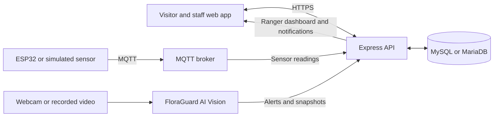
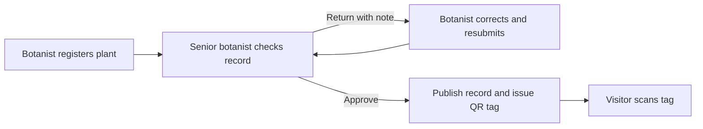

# FloraScan

FloraScan is a biodiversity registry prototype for Niah National Park
(COS30049). Botanists register plants, senior botanists verify the records, and
visitors scan QR tags to see published specimens. Rangers monitor sensor and
camera alerts. The web app supports English, Bahasa Melayu and Chinese.

## Architecture



React and Vite power the web app. Express checks role permissions, stores
records and audit history, and delivers alerts to rangers.

## Quick start

You need **Node.js 22.12+** and **MySQL or MariaDB**. On Windows with XAMPP,
start **MySQL** in the XAMPP Control Panel.

Run these PowerShell commands from the repository root.

```powershell
npm ci
if (!(Test-Path .env)) { Copy-Item .env.example .env }
npm run db:setup
npm run dev
```

On macOS or Linux, use `cp -n .env.example .env` to create the environment file
if it is missing. The default database URL is
`mysql://root@127.0.0.1:3306/plant_registry`. Update `DATABASE_URL` in `.env` if
your database uses different credentials or a different port.

Open the HTTPS address printed in the terminal. For a phone demo, connect to
the same Wi-Fi or hotspot and open `/connect` for the QR link and local
certificate instructions.

`npm run db:setup` applies the schema and seeds an empty registry. Use
`npm run db:setup -- --reset` only to erase and rebuild a disposable local
database. Keep `.env` and certificate keys out of Git.

## Demo walkthrough



Visitors can browse tagged plants and species in **Explore**. Staff sign in at
`/login`. These fictional accounts are seeded for the local demo. The password
is the part of the email before `@`, followed by `123`.

| Role | Demo email | Try this |
| --- | --- | --- |
| Botanist | `grace.lim@florascan.test` | Register plants (and correct returned ones), print QR tags |
| Senior Botanist | `aisyah.rahman@florascan.test` | Review, correct, approve or return records; archive |
| Ranger | `ahmad.rosli@florascan.test` | View and resolve alerts |
| Administrator | `farah.hamid@florascan.test` | Manage staff and audit logs |

The demo uses real species and credited reference photos with fictional
individual plant records. The API withholds sensitive locations from visitors
according to the configured conservation threshold.

## AI Vision and IoT

- **FloraGuard** accepts a webcam or a recorded video. Draw and save a plant
  zone before starting the **Live** view. When configured to send alerts,
  FloraGuard can attach a snapshot for rangers in `/staff/iot`.
  [AI Vision setup and model tests](ai-vision-node/README.md)
- **ESP32** publishes readings to the MQTT broker. Run the simulated sensor
  suite for a software-only demo, or follow the hardware guide to wire and
  flash the board. [ESP32 setup and wiring](iot-kit/README.md)

## Testing

Use a separate local database. `npm test` reseeds it and the suites write
fixture records. Start a test server with the following environment.

```powershell
$env:DATABASE_URL = 'mysql://root@127.0.0.1:3306/florascan_demo_qa'
$env:PORT = '48673'
npm run db:setup
npm run dev:test
```

In a second terminal, set the same `DATABASE_URL` and `PORT`, then run the
suites. For MQTT, set the same `MQTT_URL` and `MQTT_TOPIC_PREFIX` in both
terminals before starting the server. Use a dedicated test broker and leave
SMTP credentials empty. Browser tests use Chrome or Edge.

```powershell
npm test
npm run test:iot
```

`npm test` covers security, staff workflow, search, translations, API,
browser and passkey checks. To run a production build, use `npm run build`
followed by `npm run preview`.

- [Demo branch and full test guide](docs/demo-branch.md)
- [GitHub Actions workflow](.github/workflows/ci.yml)
- [Repository test report](test-report/index.html)

## Project layout

| Path | Contents |
| --- | --- |
| `FloraScan-Web-App/` | Public views and staff dashboards |
| `Server/` | API, database access, MQTT and camera alert handling |
| `ai-vision-node/` | FloraGuard model runtime and camera pipeline |
| `iot-kit/` | ESP32 firmware |
| `scripts/` and `tests/` | Database setup, imports and automated tests |

Use `demo` for demo integration and `main` as the mainline. Branch from the
intended target and include relevant test results in the pull request.
