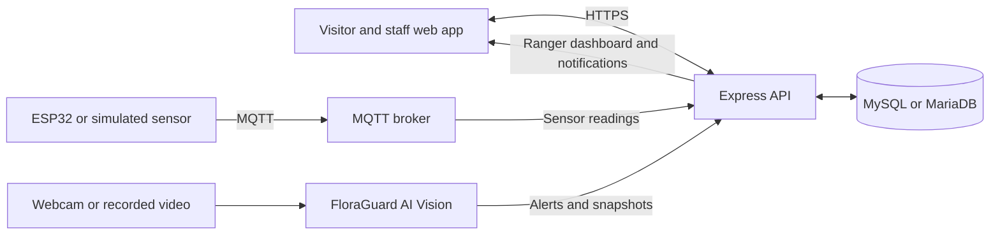
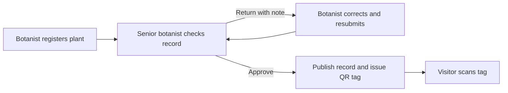

# FloraScan

FloraScan is a biodiversity registry prototype for Niah National Park
(COS30049). Botanists register plants, senior botanists verify the records, and
visitors scan QR tags to see published specimens. Rangers monitor sensor and
camera alerts. The web app supports English, Bahasa Melayu and Chinese.

## Architecture



React and Vite power the web app. Express checks role permissions, stores
records and audit history, and delivers alerts to rangers.

## Quick start

You need **Node.js 22.12+** and **MySQL or MariaDB**. On Windows with XAMPP,
start **MySQL** in the XAMPP Control Panel.

Run these PowerShell commands from the repository root.

```powershell
npm ci
if (!(Test-Path .env)) { Copy-Item .env.example .env }
npm run db:setup
npm run dev
```

On macOS or Linux, use `cp -n .env.example .env` to create the environment file
if it is missing. The default database URL is
`mysql://root@127.0.0.1:3306/plant_registry`. Update `DATABASE_URL` in `.env` if
your database uses different credentials or a different port.

Open the HTTPS address printed in the terminal. For a phone demo, connect to
the same Wi-Fi or hotspot and open `/connect` for the QR link and local
certificate instructions.

`npm run db:setup` applies the schema and seeds an empty registry. Use
`npm run db:setup -- --reset` only to erase and rebuild a disposable local
database. Keep `.env` and certificate keys out of Git.

**Everyone starts from the same data.** Every copy of the database is built
from one seed (`Server/seed.js`): the same plants, species, sensor, camera and
staff accounts. A database set up before 27 November 2026 still has the old
`@florascan.test` logins. Run `npm run db:setup -- --reset` once to rebuild it
with the accounts below; this erases anything added to it by hand.

## Demo walkthrough



Visitors can browse tagged plants and species in **Explore**. Staff sign in at
`/login`. These staff accounts are seeded for the local demo. The password
is the part of the email before `@`, followed by `123`.

| Role | Demo email | Try this |
| --- | --- | --- |
| Botanist | `drsuehanlee@gmail.com` | Register plants (and correct returned ones), print QR tags |
| Senior Botanist | `drmeilingwong@gmail.com` | Review, correct, approve or return records; archive |
| Ranger | `edmundguoqianyu@gmail.com` | View and resolve alerts |
| Administrator | `nengyichieng@gmail.com` | Manage staff and audit logs |
| Super Admin | `superadmin@gmail.com` | Open everything, including administrator accounts |

The other seeded staff are `hansjiasynyee@gmail.com` (botanist),
`limyon@gmail.com`, `edwardngiejieling@gmail.com` and
`darrenyueyangchong@gmail.com` (rangers), and `jiaqihu@gmail.com`
(administrator).

Only a super admin can reset, change or deactivate a super admin, or give
someone the role, so a breached administrator cannot lock it out. Any
administrator can still unlock one after too many wrong passwords. To
create or promote one on an existing database, run this on the server:
`npm run superadmin -- <email> ["Full Name"]`. Run `npm run db:setup` first
if the database predates the role.

The demo uses real species and credited reference photos with fictional
individual plant records. The API withholds sensitive locations from visitors
according to the configured conservation threshold.

Email goes out only when `SMTP_USER` and `SMTP_PASS` are set in `.env`;
otherwise reset codes and alert emails are printed in the server terminal.
Leave SMTP empty for demos unless every seeded address belongs to the team, or
camera alerts and reset codes will be emailed to those inboxes.

## Staff account security

- Two-step verification with an authenticator app, passkeys (fingerprint or
  face), recovery codes and a recovery email. A forgotten password needs an
  administrator's approval to reset.
- In **System settings** an administrator chooses what too many wrong
  passwords or codes lock (the account, the IP address, the device, or any
  combination), after how many attempts (3 to 20) and for how long (1 to 1440
  minutes). The default locks the account for 15 minutes after 5 attempts.
- The audit trail is for administrators only, and can restore a plant,
  species, staff account or setting to how it was before a change.

## AI Vision and IoT

- **FloraGuard** accepts a webcam or a recorded video. Draw and save a plant
  zone once before starting the **Live** view. It finds the FloraScan server
  on the same computer by itself and sends every ALERT, with its snapshot, to
  the rangers in `/staff/iot`, so a demo needs no set-up. An ALERT needs a
  hand touching the plant in 3 of the last 6 frames, backed by moving leaves
  or green in the hand crop. `npm run demo` starts the server and FloraGuard
  together; `npm run ai` starts FloraGuard alone. It runs on the CPU with
  OpenVINO, and on an NVIDIA GPU once the CUDA build of PyTorch and
  `requirements-train.txt` are installed.
  [AI Vision setup and model tests](ai-vision-node/README.md)
- **ESP32** publishes readings to the MQTT broker. Run the simulated sensor
  suite for a software-only demo, or follow the hardware guide to wire and
  flash the board. [ESP32 setup and wiring](iot-kit/README.md)

## Testing

Use a separate local database. `npm test` reseeds it and the suites write
fixture records. Start a test server with the following environment.

```powershell
$env:DATABASE_URL = 'mysql://root@127.0.0.1:3306/florascan_demo_qa'
$env:PORT = '48673'
npm run db:setup
npm run dev:test
```

In a second terminal, set the same `DATABASE_URL` and `PORT`, then run the
suites. For MQTT, set the same `MQTT_URL` and `MQTT_TOPIC_PREFIX` in both
terminals before starting the server. Use a dedicated test broker and leave
SMTP credentials empty. Browser tests use Chrome or Edge.

```powershell
npm test
npm run test:iot
```

`npm test` covers security, staff workflow, search, translations, API,
browser and passkey checks. FloraGuard's tests need no server: from
`ai-vision-node/`, run `python -I scripts/test_pipeline.py` and
`python -I scripts/test_notifier.py`. To run a production build, use
`npm run build` followed by `npm run preview`.

GitHub Actions runs every suite on each push to any branch and on pull
requests into `main` and `demo`, one run per branch at a time. Three passkey
checks fail now and then (the set-up screen carries on without saving when its
request fails); re-run the job if those are the only failures.

- [Demo branch and full test guide](docs/demo-branch.md)
- [GitHub Actions workflow](.github/workflows/ci.yml)
- [Repository test report](test-report/index.html)

## Project layout

| Path | Contents |
| --- | --- |
| `FloraScan-Web-App/` | Public views and staff dashboards |
| `Server/` | API, database access, MQTT and camera alert handling |
| `ai-vision-node/` | FloraGuard model runtime and camera pipeline |
| `iot-kit/` | ESP32 firmware |
| `scripts/` and `tests/` | Database setup, imports and automated tests |

Use `demo` for demo integration and `main` as the mainline. Branch from the
intended target and include relevant test results in the pull request. `main`
keeps a linear history, so pull requests into it are squashed or rebased, not
merged with a merge commit.
