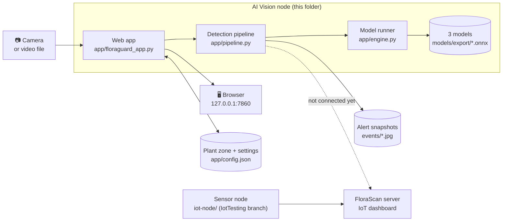
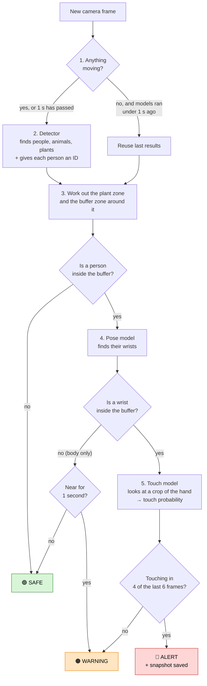
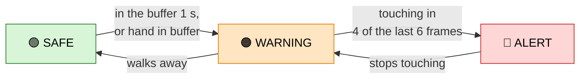
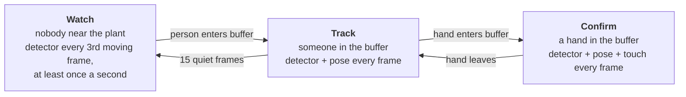
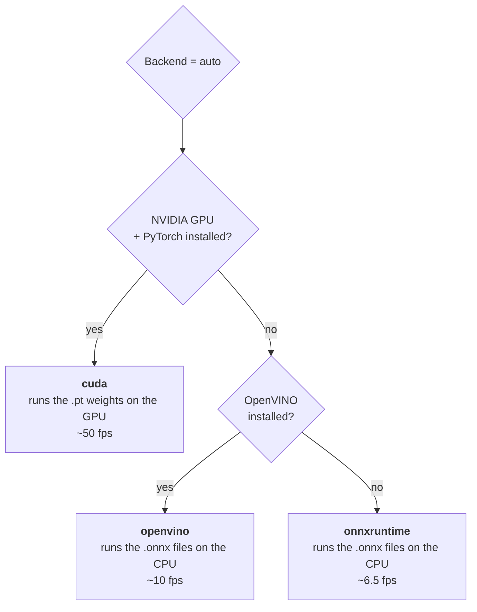
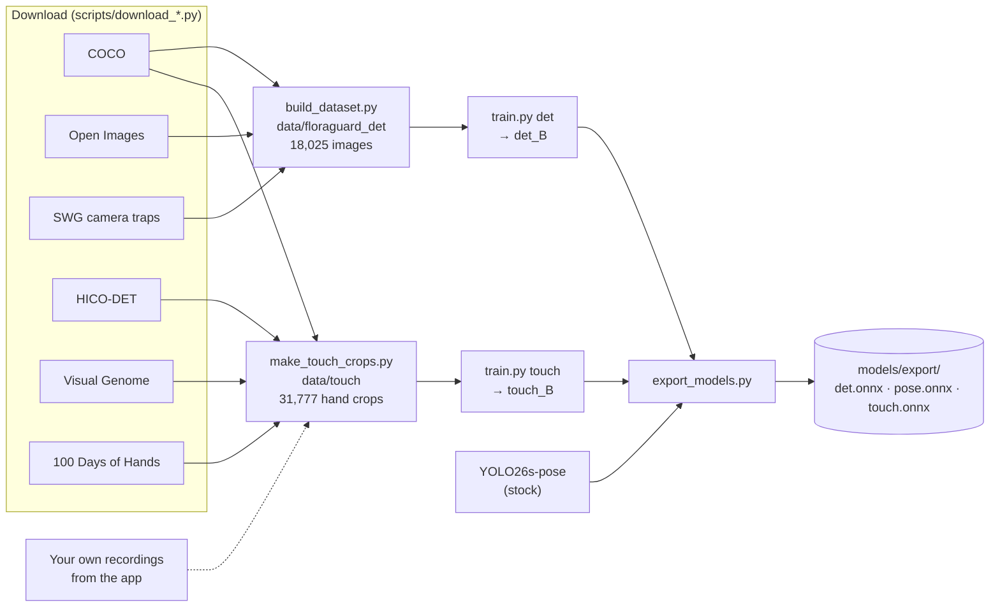

# FloraGuard: AI Vision node

The camera part of the FloraScan IoT system. It watches a protected plant through a camera and
warns when a person gets too close or touches it.

- **SAFE**: a person is in view, away from the plant.
- **WARNING**: a person stays inside the buffer zone around the plant for 1 second, or puts a hand inside it.
- **ALERT**: a hand is touching the plant in 4 of the last 6 frames, and the plant backs it up
  (its leaves move, or the hand is among green plant pixels). A snapshot is saved.
- Animals are detected and labelled, but never trigger an alert (they live in the forest).

It runs on a normal laptop CPU with no GPU (OpenVINO, about 10 frames per second), and uses an
NVIDIA GPU if there is one.

> The sensor node (soil, rain, motion, sound) is a separate part, in `iot-node/` on the
> `IotTesting` branch. This node does not send its alerts to the FloraScan server yet.

---

## Architecture

The diagrams below are drawn by GitHub from the text (Mermaid). Open this file on GitHub, or in
VS Code with a Mermaid preview extension, to see them.

### 1. The big picture



- The **web app** reads the camera, shows the live picture, and lists warnings and alerts.
- The **pipeline** decides, frame by frame, whether each person is SAFE, WARNING or ALERT.
- The **model runner** runs the three neural networks on whatever hardware is available.

### 2. What happens to each camera frame

Each step only runs when the step before it found something. That is what keeps it fast on a laptop
CPU: most of the time nobody is near the plant, and only the cheap first steps run.



| Step | Model | What it does | Runs when |
| --- | --- | --- | --- |
| 1. Motion check | none (background subtraction) | Compares the frame with the recent background | Every frame |
| 2. Detector | YOLO26s, **trained by us** | Boxes people, animals and plants. A tracker keeps each person's ID across frames. | Something moves, or once a second |
| 3. Zones | none | Plant zone = the shape you drew (Live needs one; `require_zone`). Without one (scripts, tests), each detected plant. Buffer = plant zone grown by 25% of its width. | Every frame |
| 4. Pose | YOLO26s-pose (stock) | Finds wrists and elbows, on a crop around the nearby people only | Someone is inside the buffer |
| 5. Touch | YOLO26s-cls, **trained by us** | Says `touch` or `no_touch` for a 224×224 crop of each hand | A wrist is inside the buffer |

### 3. The three stages

Every person has their own stage. The stage shown at the top of the screen is the worst one.



Walking away from ALERT goes straight back to SAFE.

**What counts as "touching"** in a frame (any one is enough):

- The touch model is at least **60%** sure, **or**
- The wrist is inside the plant itself, the plant's leaves are moving, **and** the touch model is at least **20%** sure.
  The leaf check helps because public datasets have few photos of hands on plants, so the model
  under-scores real touches.

**The plant must back it up.** A touch frame also needs plant evidence: the plant's leaves are moving,
**or** at least **15%** of the hand crop is green vegetation (excess-green index, 2G − R − B). So the
touch model alone can never alert: a hand holding a camera in front of a coat stays a WARNING. Either
one is enough, because a bare winter tree has no green but its branches move when someone prunes it.

**Debounce:** ALERT needs **4** touch frames among the last **6** model frames (`touch_frames`,
`touch_window`; `touch_window: 0` = 4 in a row, the old rule). One weak frame no longer resets the count.

Leaf movement is measured against a baseline learned while nobody is near, so wind and changing
light don't count as a touch.

**Alerts and snapshots:**

- The same person gets the same warning at most once every **10 seconds**.
- Only **ALERT** and **AFTER-HOURS** (someone there outside opening hours, if switched on) save a snapshot to `events/`.
- All numbers above are defaults in `app/pipeline.py` (`DEFAULTS`). Most can be changed in the app under **Thresholds**.

### 4. Plant zone and buffer zone

```
+------------------------------- camera view -------------------------------+
|                                                                           |
|   person far away            + - - - - buffer zone - - - - +              |
|   = SAFE                     :                             :              |
|                              :   +---- plant zone -----+   :              |
|                              :   |                     |   :              |
|   person stands  ----------> :   |   hand on plant     |   :              |
|   in here for 1 s            :   |   = ALERT           |   :              |
|   = WARNING                  :   +---------------------+   :              |
|                              :                             :              |
|                              + - - - - - - - - - - - - - - +              |
+---------------------------------------------------------------------------+
```

- **Plant zone** (green): the shape you click around the plant in the **Plant zone** tab. If you
  don't draw one, every plant the detector finds becomes a plant zone.
- **Buffer zone** (orange): drawn automatically around the plant zone.
- A plant hidden behind a person is **remembered** for up to 4 seconds (drawn dashed), so stepping
  in front of a plant doesn't make it disappear.

### 5. Saving CPU: three speed modes

The pipeline changes how hard it works depending on what it sees.



The app also caps processing at **15 frames per second** (changeable under **Performance**). The
camera is read on its own thread, so a slow frame is skipped rather than building up a delay.

### 6. Which hardware runs the models



A small device without a GPU only needs `app/`, `models/export/` and `requirements.txt`.

### 7. How the models were made (offline)

This only matters if you retrain. See [Retraining](#retraining-optional).



---

## Run it

You need **Python 3.12** and a webcam (or a video file).

```bash
cd ai-vision-node
python -m venv .venv
.venv\Scripts\activate          # Windows. On Linux/macOS: source .venv/bin/activate
pip install -r requirements.txt
git lfs pull                    # gets the models and videos if your clone only has pointers
python app/floraguard_app.py
```

It opens **http://127.0.0.1:7860** in your browser.

1. Pick **Webcam** (index 0 is usually the built-in camera) or **Video file**. There are two test
   videos in `data/test_videos/`.
2. Optional: open **Plant zone**, click **Grab frame**, click 6-10 points around the plant, then
   **Save zone**.
3. Open **Live** and click **Start**. Warnings and alerts appear on the right, with snapshots.

Settings you can change in the app:

| Section | What it changes |
| --- | --- |
| **Thresholds** | How confident the detector must be, how long before WARNING, how many touch frames before ALERT, and the after-hours alert |
| **Performance** | Backend (`openvino` = CPU only, `cuda` = NVIDIA GPU), number of CPU threads, and a frame rate cap |
| **Record touch-model training data** | Saves hand crops to `data/touch_user/` while you demo, to retrain the touch model for your own camera |

The plant zone and settings you save are stored in `app/config.json` (not committed, since every
camera is different). Alert snapshots go to `events/`.

### If something goes wrong

| Problem | Fix |
| --- | --- |
| `No exported models: run python scripts/export_models.py` | The model files are missing or are still LFS pointers. Run `git lfs pull`. |
| `no inference backend: pip install openvino` | Run `pip install -r requirements.txt`. |
| `Could not open the video source` | Wrong webcam index, or another app is using the camera. Try index 1. |
| Very low frame rate | Lower **CPU threads** or **Max processed FPS**, or export a smaller detector (see below). |

---

## What is in this folder

```
app/
  floraguard_app.py   The web app (Gradio): Live and Plant zone tabs
  pipeline.py         The detection steps and the SAFE / WARNING / ALERT rules, with all default settings
  engine.py           Runs the models on OpenVINO, ONNX Runtime or CUDA
  tracker.py          Keeps the same ID on a person from frame to frame
  touchcrop.py        Cuts the hand crop the touch model looks at
models/
  export/             det.onnx, pose.onnx, touch.onnx + models.json   <- what the app runs
  yolo26*.pt          Base Ultralytics weights we started training from
runs/
  detect/det_B/       Final detector training run (best.pt, results, charts)
  classify/touch_B/   Final touch model training run
reports/              Test results: det.json, touch.json, speed.json
data/
  touch/              Touch / no_touch hand crops used to train the touch model (31,777 images)
  test_videos/        Two clips for trying the app without a camera
  floraguard_det/     manifest.csv: the exact list of detector training images (images not included)
scripts/              Download datasets, build them, train, evaluate, export (see below)
```

**Git LFS** stores the large files: `*.onnx`, `*.pt`, `*.mp4` and the images in `data/touch/`.
Install it once with `git lfs install` before cloning.

---

## Results

Measured on the test split, and on the dev laptop (Ryzen AI 7, RTX 5060).

| Model | Result |
| --- | --- |
| Detector | mAP50 **0.79** overall: person 0.82, animal 0.83, plant 0.72 |
| Touch classifier | Accuracy **0.79**; when it says "touch" it is right 83% of the time, and it catches 71% of touches |

| Backend | Frames per second (full pipeline, worst case) |
| --- | --- |
| CUDA (RTX 5060) | about 50 |
| OpenVINO, 4 CPU threads | about 10 |
| OpenVINO, 2 CPU threads | about 7 |
| ONNX Runtime, 4 CPU threads | about 6.5 |

Full numbers are in `reports/`.

**Known weak spot:** plants that fill the whole frame (like a wall of ivy) are often not detected
as one plant. Draw a **Plant zone** for those instead of relying on the detector.

---

## Retraining (optional)

You only need this to change the models. It needs an NVIDIA GPU and the training packages:

```bash
pip install torch torchvision --index-url https://download.pytorch.org/whl/cu130   # pick your CUDA version
pip install -r requirements-train.txt
```

### Datasets

The training images are **not** in git: together they are about 45 GB. The scripts download them
again into `data/raw/` and `data/staging/`.

| Dataset | Used for | Script |
| --- | --- | --- |
| COCO 2017 | people, animals, potted plants | `download_coco.py` |
| Open Images V7 | people, animals, houseplants | `download_openimages.py` |
| SWG Camera Traps (LILA BC) | forest animals from camera traps | `download_swg.py` |
| HICO-DET | people holding or near plants (touch data) | `download_hico_plants.py` |
| Visual Genome | people touching or near plants (touch data) | `scan_vg_plants.py`, then `download_vg_plants.py` |
| 100 Days of Hands | hands in contact or not (touch data) | download `pascal_voc_format.zip` by hand into `data/raw/100doh/` |

The detector set has 18,025 images (COCO 5,984 · Open Images 5,279 · SWG 6,762), split by
`data/floraguard_det/manifest.csv`.

HICO-DET and 100 Days of Hands are for research use only. Keep this repository private.

### Steps

Run these from `ai-vision-node/`, one at a time:

```bash
python scripts/download_coco.py
python scripts/download_openimages.py --total 4500
python scripts/download_swg.py --per-category 150 --empty 800
python scripts/fill_missing_labels.py --sources openimages swg
python scripts/build_dataset.py --sources swg coco openimages
python scripts/check_dataset.py data/floraguard_det/data.yaml --grids 2

python scripts/download_hico_plants.py
python scripts/scan_vg_plants.py
python scripts/download_vg_plants.py
python scripts/make_touch_crops.py

python scripts/train.py det        # stage A (frozen backbone), then stage B (full fine-tune)
python scripts/train.py touch
python scripts/evaluate.py det
python scripts/evaluate.py touch
python scripts/evaluate.py speed
python scripts/export_models.py    # writes models/export/, which is what the app uses
```

`bash scripts/run_all.sh` runs the training and evaluation steps in order and logs to `logs/`.

`data/floraguard_det/data.yaml` holds an absolute path (`path: D:/Innovation_AI_Vision/...`).
`build_dataset.py` rewrites it for your machine.

### Smaller models for a weak CPU

```bash
python scripts/export_models.py --det-size 480   # faster detector, mAP50 0.79 -> 0.76
python scripts/export_models.py --pose n         # nano pose model, less precise wrists
```

### Make the touch model fit your camera

1. In the app, open **Record touch-model training data** while **Live** is running.
2. Pick **touch** and touch the plant in different ways, then **no_touch** and reach near it without touching.
3. Run `python scripts/make_touch_crops.py`, then `python scripts/train.py touch`, then
   `python scripts/export_models.py`.

### Tests

```bash
python scripts/test_pipeline.py
```

Plays scripted scenes through the pipeline (tracking, remembered plants, warning cooldowns) and
prints PASS or FAIL for each. It needs no camera; the detector is replaced by a script.
